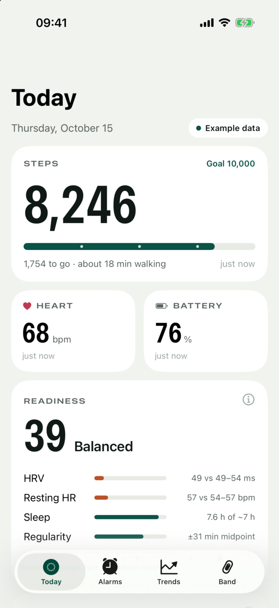
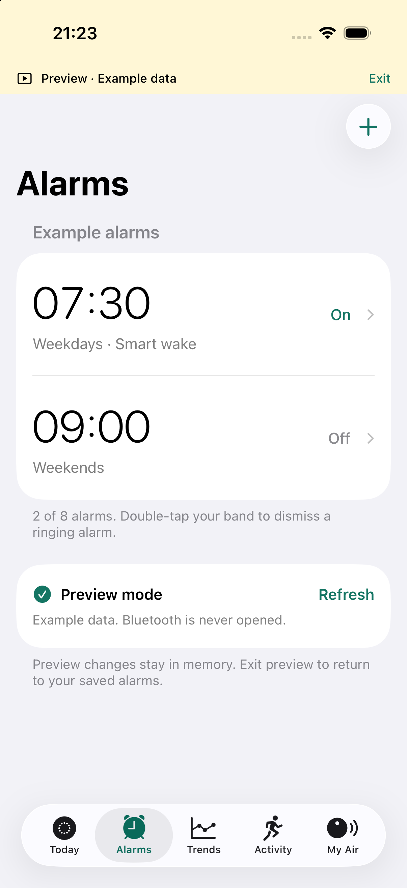
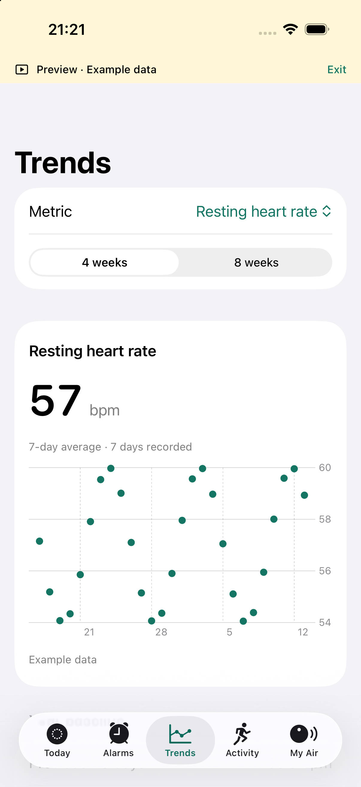
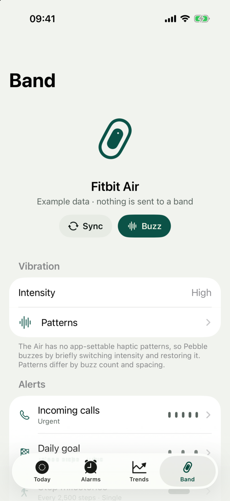
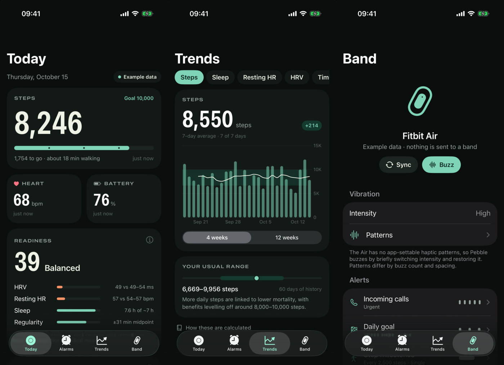

<p align="center"></p>

# Pebble

A native, offline iPhone companion for the Fitbit Air. Alarms, vibration
alerts, live heart rate and evidence-based training and recovery trends, built
on short authenticated Bluetooth sessions that share the band with Google Health.
No firmware changes, no account, no cloud.

**Website:** [medpar.github.io/air-companion](https://medpar.github.io/air-companion/)

<p>




</p>

> Independent interoperability research. Not affiliated with, endorsed by or
> supported by Google or Fitbit. Fitbit and Fitbit Air are trademarks of Google
> LLC. Use it only with a band you own, at your own risk.

## How it works

The Air talks to phones over Google's open-source
[Golden Gate](https://github.com/Google-Health-API/golden-gate) stack: a tiny
IP network carried over Bluetooth LE, secured with DTLS, speaking CoAP with
protobuf payloads. Pebble embeds the same stack (plus Mbed TLS) in a small C
bridge and talks to the band the way the official app does — only through a
short, fixed list of routes.

```
 iPhone (Pebble)                                              Fitbit Air
 ─────────────────────────────────────────────────────────────────────────
 Protobuf     Alarms · Settings · LiveActivity · DeviceInfo · EventSet
 CoAP         GET /alarms · PUT|POST /settings · GET /liveactivity …
 DTLS 1.2     PSK, TLS_PSK_WITH_AES_128_CCM (0xC0A4), extended master secret
              band = DTLS client, phone = DTLS server
 NIP          IPv4 / UDP, port 5684 both ends
 Gattlink     reliable, windowed fragmentation (sequence numbers + ACKs)
 BLE GATT     service 0xFD62 · phone writes ABBAFF01 · band notifies ABBAFF02
```

### Keys and the handshake

Every Air has two 16-byte pre-shared keys (primary and secondary), each with a
32-bit key ID, held by Google's cloud. When a session starts the band, acting as
DTLS client, sends a PSK identity of the form `MD-<key ID, 8 hex>-<expiry, 8 hex>`.
Pebble looks up the matching raw key and completes the handshake as the server.
The suite was confirmed from a live Bluetooth trace, and offline decryption of
that trace verified both `Finished` messages and all 131 application records
before any custom code touched the band.

You need your own band's keys. They were recovered for this project with a
scoped, single-use mitmproxy addon ([`scripts/device_key_capture.py`](scripts/device_key_capture.py))
that watched the official app's own traffic and made a bounded, single-use
read of the paired Air's keys. It never saves credentials, cookies or unrelated bodies. The full
method — and its limits — is in the [research log](docs/RESEARCH.md). Pebble
imports a JSON file shaped like
`{"keys":{"primaryKey":{"key":"<base64>","keyId":123},"secondaryKey":{…}}}`,
moves it into the device-only Keychain and deletes the file.

### One owner at a time

The Air accepts one secure session at a time. If Pebble held the link, Google
Health would stop syncing. So every job is a short session: connect, handshake,
do one thing, disconnect. An activity read takes about 3 s, a full sync about
5 s, and every session has a 35 s hard timeout.

### Routes Pebble uses

| Route | Method | What it carries |
| --- | --- | --- |
| `/alarms` | GET | Capabilities (up to 8 alarms, smart wake) and alarm entries |
| `/alarms` | POST | Create one alarm `Configuration` |
| `/alarms/{id}` | PUT / DELETE | Replace or delete one alarm |
| `/settings/capabilities` | GET | Supported settings, haptic intensities (1 off · 2 low · 3 high), goal types |
| `/settings` | PUT | **Query** the haptic setting — this protocol uses PUT for a read |
| `/settings` | POST | Change the haptic intensity (the band buzzes as a preview) |
| `/liveactivity` | GET | Steps (field 2), heart rate (field 7), confidence (field 8) |
| `/device/info` | GET | Battery percentage (field 13) |

An alarm `Configuration` is: enabled, repeats, smart wake, recurring, a time
(hour, minute, second) and a weekday bitmask with Monday = bit 0. Unknown
protobuf fields are preserved on every edit.

## Signals

What the band can tell the phone, and what it can be made to do.

**Reads.** Steps and heart rate snapshots (`/liveactivity`), battery
(`/device/info`), alarms and settings. Each reading is timestamped; an old
count is never shown as today's.

**Live heart rate.** With *Share heart rate* on in Google Health, the Air also
exposes the standard Bluetooth Heart Rate Profile (`0x180D`, measurement
`0x2A37`): beats per minute plus RR intervals in 1/1024 s. Pebble uses it for
heart-rate-reserve zones, RMSSD over the last 120 RR intervals and Edwards
training load. This is a read-only, unauthenticated path that needs no keys.

**Events.** The band is also a CoAP client: it POSTs an `EventSet` to `/events`
and `/eventsSecure` on the phone. Event IDs are four ASCII characters packed
big-endian — `rset`, `bsnc`, `cgps`, `ping`, `aofl`, `wrs+` and `wrs-` (wrist
on/off). This Air has only ever sent `rset`. Pebble's **Listen for band events**
screen shows any code it receives, unknown ones included.

**Vibration.** There is no "buzz" command. The only verified way to make the
Air vibrate is to change its haptic intensity (Low ↔ High), which plays a
preview, then restore it. Each change is a Bluetooth round trip of about a
second, so patterns differ by pulse count and spacing, not rhythm:

| Pattern | Pulses | Gap between pulses |
| --- | --- | --- |
| Single | 1 | — |
| Double | 2 | 1.8 s |
| Triple | 3 | 1.8 s |
| Long gap | 2 | 3.4 s |
| Urgent | 5 | 0.9 s |

A pulse is: toggle → hold 0.3 s → restore. The original intensity is journaled
first, and read back once at the end. Gaps under about 1.2 s feel identical on
the wrist because they sit at the round-trip floor.

### What the Air can't do from an iPhone

- **Other apps' notifications.** Bands that show notifications on an iPhone use
  Apple's ANCS from their firmware. The Air doesn't subscribe to ANCS (confirmed
  with a Bluetooth trace), and iOS gives no app access to other apps'
  notifications. Pebble uses Shortcuts automations instead: *Message* or *Email*
  trigger → **Buzz Band**.
- **LED colour.** Static analysis found no app-addressable LED for any Fitbit
  model. The Air's light is firmware battery status (white ≥20 %, red <20 %).
- **Double-tap as a phone trigger.** Double-tap is an on-band alarm dismissal
  only. No tap or gesture event is exported, and there is no accelerometer
  stream.
- **Firmware haptic patterns.** The shared Fitbit protocol has a notification
  record with a `hapticPattern` field (`POST sb/records`), but it has never been
  seen on the Air's wire and its values are undocumented. Pebble deliberately
  never sends it, `DeviceCommands` or any other unobserved write.

## The Pebble app

| Feature | How it works | Verified on the physical Air |
| --- | --- | --- |
| Alarms: add, edit, repeat, smart wake, delete | Fresh read, conflict check, protected backup, read-back verification | Yes |
| Vibration intensity (Off/Low/High) | Advertised options only, verified read-back | Yes |
| Vibration patterns | 1–5 pulses via intensity toggle, restored and verified | Yes — Triple's 3 buzzes countable |
| Per-event alerts: calls, daily goal, step milestones, move reminder, Shortcuts | Each event has its own pattern, plus an optional iPhone notification or webhook | Goal and call buzz verified |
| Background alerts | Opt-in **Keep Pebble running** (silent mixable audio, `voip` + `audio` modes) plus adaptive step checks | Background call → band buzz verified via CallKit test |
| Shortcuts & Siri | App Intents: **Buzz Band**, **Get Steps**, **Get Band Battery** | Built and registered |
| Steps, heart rate, battery | Activity-only read (~3 s) or full sync (~5 s) | Yes |
| Live heart rate | Heart Rate Profile; zones, RMSSD, Edwards load | Needs sharing turned on |
| Readiness | Transparent 0–100 score from your own HRV, resting HR, sleep and regularity | Logic tested; uses Apple Health data |
| Trends | Steps, sleep, resting HR, HRV, sleep timing, social jetlag, against your own usual range | Logic tested |
| Training | Session-RPE load, Banister fitness/fatigue/form, EWMA acute:chronic ratio, HRV CV, VO₂max norms, Karvonen zones | Logic tested |

**Alerts.** Calls come from `CXCallObserver`. Step goals and milestones are
checked adaptively — sooner when your pace is about to cross a threshold (never
under 5 minutes), otherwise every 30–60 minutes — to keep time away from
Google Health short. Every delivery is journaled before it runs, so a relaunch
never replays it. Optional webhooks post `{"event":"goal","steps":10240,…}` for
Home Assistant, n8n or your own server.

### Using it

1. Import your Air's device-key file in **Band → Device key**.
2. Pull down on Today or Alarms to sync. Pebble also syncs on open if the last
   read is over 10 minutes old.
3. Choose alerts and patterns in **Band → Alerts**. Turn on **Keep Pebble
   running** for calls and step alerts while locked; it uses extra battery.
4. Forward messages: Shortcuts → Automation → *Message* → *Run Immediately* →
   **Buzz Band**.

### Methods

Each figure is explained in the app (**Trends → How these are calculated**) and
in [docs/METHODS.md](docs/METHODS.md):

- **Usual range:** last 7 days against the previous 60. HRV uses log-scaled
  ±0.5 SD (Plews et al. 2013); resting HR and sleep ±1 SD.
- **Training:** session RPE × minutes (Foster et al. 2001); fitness and fatigue
  are 42- and 7-day exponentially weighted loads (Banister et al. 1975);
  EWMA acute:chronic ratio (Williams et al. 2017).
- **Cardio fitness:** VO₂max ≈ 15.3 × HRmax / HRrest (Uth et al. 2004), HRmax =
  208 − 0.7 × age (Tanaka et al. 2001), ranked against Cooper Institute norms.
- **Sleep timing:** main-episode midpoint; regularity is its 14-night SD; social
  jetlag is the weekend vs weekday gap (Wittmann et al. 2006).
- **Readiness:** HRV 40, resting HR 25, sleep 25, regularity 10, rescaled to the
  inputs available. A transparent heuristic, not a diagnosis.

## Safety model

- Every band write reads fresh state first, keeps a protected backup and
  verifies the result by reading it back. Conflicting changes are never
  overwritten.
- The C bridge exposes only the routes above. There are no firmware, reset,
  pairing, sync-acknowledgement or arbitrary-command paths.
- A known firmware quirk is handled explicitly: creating an alarm returns CoAP
  5.00 and enables it even when it was sent disabled. Pebble never retries the
  POST; it reads back, finds exactly one new alarm and applies one corrective PUT.
- Keys live in the device-only Keychain. No analytics, account or server.
  Health data is read-only and kept per source.
- Raw captures, identifiers, keys and proprietary files stay in ignored
  `.private/` storage and are never committed.

## Build

Requires macOS, Xcode with an iOS 18+ SDK, CMake 3.25+, Git and curl.
`prepare-native.sh` fetches Golden Gate and Mbed TLS at pinned, hash-checked
versions into `.private/references`.

```sh
./scripts/prepare-native.sh
./scripts/build-simulator.sh
xcrun simctl install booted .private/simulator-project/Debug-iphonesimulator/AirCompanion.app
xcrun simctl launch booted com.medpar.air.companion --preview
```

Signed phone build (your own team; free Personal Team signing lasts 7 days):

```sh
AIR_DEVELOPMENT_TEAM=YOUR_TEAM_ID ./scripts/build-ios.sh
xcrun devicectl device install app --device DEVICE_ID .private/ios-project/Debug-iphoneos/AirCompanion.app
```

Set `CMAKE_BIN` if `cmake` isn't on your `PATH`. `--preview` runs on example
data and never opens Bluetooth.

### Offline checks

```sh
./scripts/check-offline.sh
```

Runs the encrypted synthetic-peer transport test (two processes completing DTLS
and real CoAP alarm CRUD over 20-byte Gattlink fragments), the alarm parser,
fitness/alert engine, storage tests and 29 Python research-tool tests. No
phone, band or key is needed.

### USB diagnostics

`devicectl … process launch … com.medpar.air.companion` with
`--diagnostic-refresh`, `--diagnostic activity`, `--diagnostic events`,
`--diagnostic pattern <single|double|triple|longGap|urgent>`,
`--diagnostic call-check`, `--diagnostic background-check`, `--preview` or
`--tab N`. Reports go to the app's private `Documents/connection-report.json`.

## Documents

[Protocol](docs/PROTOCOL.md) · [Research log](docs/RESEARCH.md) ·
[Device acceptance](docs/DEVICE-ACCEPTANCE.md) · [Methods](docs/METHODS.md) ·
[Third-party notices](Native/THIRD_PARTY.md)


