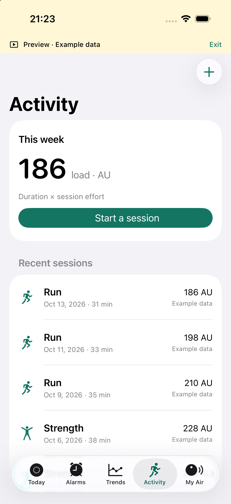

# Air Companion

A native SwiftUI iPhone companion and interoperability project for Fitbit Air.
Built around short, authenticated Bluetooth sessions, local storage and a quiet,
native iPhone interface. **Development build; not yet a complete replacement for
Google Health.** No firmware changes, unpairing or device resets.

## What is implemented

| Feature | App implementation | Device evidence |
| --- | --- | --- |
| Read alarms | Authenticated read, cache, diagnostics | One successful real Air read; original companion remained normal |
| Add, edit, repeat, delete alarms | Fresh-state conflict check, protected transaction backup, one mutation, read-back verification | Synthetic encrypted peers and parser tests; physical writes pending |
| Band vibration intensity | Reads capabilities and current value; exposes only advertised options; preserves unknown fields and verifies changes | Protocol recovered statically; actual Air support and writes pending |
| Steps and current heart rate | Explicit refresh, timestamped snapshots, confidence filter, daily history | Routes/schema identified; physical app readings pending |
| Apple Health trends | Read-only import, per-device/source selection, daily sleep/RHR/SDNN values, 7-day vs 28-day comparison | Builds; aggregation logic tested; real import permission/data pending |
| Workouts | Session timer with relaunch recovery, manual logs, Health imports, effort ratings, session-RPE load | Offline logic and persistence tested |
| Daily step notification | Once per rule per local day, on iPhone, after a current-day refresh | Rule engine tested; notification delivery needs device acceptance |
| Calls/app notifications on band | Saved automation drafts | No verified notification route for this Air |
| Custom band vibration/LED events | Saved desired-action drafts; no guessed commands | Event transport and supported lights/patterns unresolved |
| Double-tap → phone action | Saved gesture/shortcut drafts | No verified exported gesture event |

Preview mode uses clearly labelled examples, stays in memory, and never opens
Bluetooth or reads Apple Health. Switch it on in **My Air → Development**.
Unverified automations remain drafts: a toggle cannot manufacture missing band
firmware or iOS capabilities.

## Build

Requires macOS, Xcode with an iOS SDK, CMake 3.25+, Git and curl. Verified with
Xcode 27 and CMake 3.31.10 on Apple Silicon. Deployment target: iOS 18.

```sh
./scripts/prepare-native.sh
./scripts/build-simulator.sh
```

The simulator app is at
`.private/simulator-project/Debug-iphonesimulator/AirCompanion.app`. Install into
a booted simulator, then launch the offline example:

```sh
xcrun simctl install booted .private/simulator-project/Debug-iphonesimulator/AirCompanion.app
xcrun simctl launch booted com.medpar.air.companion --preview
```

For a signed phone build (does **not** install or launch on a phone):

```sh
AIR_DEVELOPMENT_TEAM=YOUR_TEAM_ID ./scripts/build-ios.sh
```

Use your own Xcode team. Free Personal Team signing is supported; Apple imposes
provisioning expiration and free-app limits. Signing may need refreshing before
later installation. The generated project is
`.private/ios-project/AirCompanion.xcodeproj`.

Import your own device-key JSON through **My Air → Import device key**, or copy
it into this app's private Documents directory as `device-keys.json`. It is
validated, moved into device-only Keychain storage, then the app-container import
file is removed. A source file imported from Files remains yours to remove.
Keys are never embedded in the binary or repository. Key retrieval is a separate
research process; the app does not request a Google account login.

## Offline checks

The Python research tests need an isolated mitmproxy runtime (the app does not):

```sh
uv venv --python 3.12 .private/tools/mitmproxy-grpc
uv pip install --python .private/tools/mitmproxy-grpc/bin/python mitmproxy==12.2.3
./scripts/check-offline.sh
```

Reuse that environment if it already exists. No proxy is started by these commands.

This runs native encrypted synthetic-peer integration, Swift alarm transactions,
fitness math, persistence/preview isolation and 29 Python research-tool tests.
No phone, band, real key or network interception is required. Dependencies must
first be prepared. `CMAKE_BIN` and `PYTHON_BIN` can select local runtimes.

The native test covers fragmented PSK DTLS, alarm CRUD, settings query/write/read,
backpressure, overlapping-request rejection, and repeated teardown. Simulator
screens are inspected with example data. These checks cannot establish physical
alarm writes, notification delivery, Bluetooth coexistence or Health permissions.

## Data and methods

- HealthKit imports the last 60 days of sleep, resting heart rate, HRV SDNN and
  workouts. It never writes Health data or silently combines different sources.
- Sleep combines overlapping asleep stages from one source in local noon-to-noon
  windows; in-bed/awake segments are excluded. DST uses calendar boundaries.
- Trends compare seven completed days with the preceding 28; a displayed change
  requires at least 4 recent and 14 baseline days. Missing values are not zero.
- Training load is duration × session RPE. Unrated sessions do not contribute.
  There is no invented readiness score, medical diagnosis or injury-risk model.
- Imported and manually entered copies of the same workout are not automatically
  deduplicated; remove the duplicate if both were recorded.

See the app's **Methods & privacy** page and [methods](docs/METHODS.md).

## Preservation and privacy

Connections begin only through explicit controls and end on completion, failure,
backgrounding or timeout. One native transport and one CoAP request run at a time.
No automatic application mutation retries. Before a write the app reads fresh
state and saves the original; it checks the actual band state afterwards. An
uncertain response is reported as “Save needs checking,” never silently retried
or rolled back.

There are no firmware, reset, provisioning, bond-management, arbitrary-command,
fuzzing or bulk-sync deletion APIs. Known normal alarm operations and a gated
haptic-intensity operation are the only settings mutations. Live step alerts are
foreground refresh-driven; there is no continuous background band monitoring.

Keys use device-only Keychain. Health data, backups and diagnostics use protected
local files. Apple device-backup settings may include non-Keychain app files.
Diagnostics exclude payloads, keys and health/alarm values. No analytics or cloud
backend. Raw captures, IDs, keys, proprietary app files and research tools stay
in ignored `.private/` storage and are excluded from this repository.

[Research record](docs/RESEARCH.md) · [Protocol boundary](docs/PROTOCOL.md) ·
[Dependency notices](Native/THIRD_PARTY.md) · [Later device acceptance](docs/DEVICE-ACCEPTANCE.md)

## Simulator preview

Screens below contain only generated example data.

<p>



</p>
